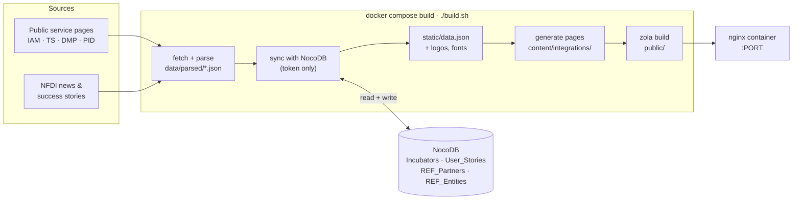

<div align="center">

# Base4NFDI Integration Dashboard

**One overview of every incubator and use case integrating the NFDI Basic Services.**

[](https://www.getzola.org/)
[](https://nodejs.org/)
[](https://nginx.org/)
[](https://docs.docker.com/compose/)
[](https://nocodb.nfdi.de)

[How it works](#how-it-works) ·
[Quick start](#quick-start) ·
[Configuration](#configuration) ·
[Operations](#operating-the-deployment) ·
[NocoDB](#working-with-nocodb) ·
[Local development](#local-development) ·
[Scripts reference](scripts/README.md)

</div>

---

The dashboard is a static website built with [Zola](https://www.getzola.org/). It tracks how consortia adopt the four Basic Services: **IAM4NFDI**, **TS4NFDI**, **DMP4NFDI** and **PID4NFDI**. Every page is generated when the Docker image is built, from the services' public pages, NFDI news, and the dashboard tables in [NocoDB](https://nocodb.nfdi.de). The running container is a plain nginx server that never contacts NocoDB.

> [!IMPORTANT]
> **The live site only changes when you rebuild the image.** Editing NocoDB, or new entries appearing on the public service pages, has no effect until the next [refresh](#refresh-the-data).

## How it works



Without a NocoDB token, the NocoDB step is skipped and the site is built from the `static/data.json` committed in the repository. Either way, the build needs **outbound internet access** to fetch source pages, news, logos and fonts.

The full list of steps is in [scripts/README.md](scripts/README.md#when-the-dashboard-updates).

### What a build writes to NocoDB

> [!WARNING]
> With `NOCODB_API_TOKEN` set, **every build writes to NocoDB**. It runs these steps with `--apply`, without a dry-run first:

| Step | Effect on NocoDB |
| --- | --- |
| `ensure-incubators-schema` | Adds missing columns to the Incubators table |
| `push-source-pages-to-nocodb` | Creates incubators listed on public pages but missing in NocoDB |
| `push-pid-use-cases-to-nocodb` | Creates missing PID use cases in User_Stories |
| `patch-published-integrations` | Overwrites cells that **differ** from the public source, copies `inc_status`, sets *Finished* after `inc_end` |

The dashboard mirrors the service websites: a build **overwrites source-backed cells** (dates, cycle, description, goals, results, service type, status, …) with the published values. It **never deletes rows**, and keeps cells the source leaves empty, titles written in NocoDB, page slugs (`key_article`), and existing partner sets. To preview the patch before it runs, use the dry-run workflow in [scripts/README.md](scripts/README.md#update-already-published-incubators-and-use-cases).

## Quick start

**Prerequisites:** Docker with Docker Compose, a checkout of this repository, and a [NocoDB API token](https://nocodb.nfdi.de/dashboard/#/account/tokens) (optional, but needed for live data).

```bash
cp .env.example .env               # then set NOCODB_API_TOKEN, BASE_URL, PORT
docker compose up -d --build       # build the image and start nginx
docker compose ps                  # wait for "healthy"
```

The site is now available at `http://localhost:8080`, or whatever `PORT` you set.

## Configuration

All settings live in `.env` in the repository root. Start from [`.env.example`](.env.example), and **never commit `.env`**.

| Variable | Required | Rebuild needed | Purpose |
| --- | :---: | :---: | --- |
| `NOCODB_API_TOKEN` | ✅ for live data | ✅ | NocoDB access. Leave empty to build from `static/data.json` |
| `BASE_URL` | ✅ | ✅ | Public address as typed in the browser, e.g. `https://dashboard.example.org`. Every internal link is built from it, so a wrong value breaks navigation |
| `PORT` | — | ❌ | Host port for nginx (default `8080`). `docker compose up -d` is enough after changing it |
| `NOCODB_*_TABLE_ID`, `NOCODB_*_VIEW_ID`, `NOCODB_BASE_URL`, `NOCODB_PAGE_SIZE` | — | ✅ | Point the build at other tables or views. The defaults match the dashboard tables |
| `FETCH_TIMEOUT_MS`, `FETCH_RETRIES` | — | ✅ | Network tuning for downloads during the build |

Variables in the *Host-only* block of `.env.example` (such as `ZENODO_COMMUNITIES_CSV`) only apply when you run maintenance scripts directly with `node scripts/…`. They are not passed to the Docker build.

> [!NOTE]
> Values reach the Docker build as **build arguments**, not through the `.env` file, which `.dockerignore` excludes. That is why any change to them needs a rebuild.

## Operating the deployment

All commands run from the repository root.

### Refresh the data

This is the command to run after reviewers edit NocoDB, or whenever the site should pick up new entries from the public sources:

```bash
CACHE_BUST=$(date +%s) docker compose up -d --build
```

> [!TIP]
> **Why `CACHE_BUST`?** Docker caches each build step. If no file in the repository changed, a plain `--build` reuses the previous pipeline run and ships **stale data**. A new `CACHE_BUST` value forces the pipeline to run again, while the Node and Zola toolchain layers stay cached. Check the build output for `pipeline run: <timestamp>`; if you see `CACHED` there instead, the data was not refreshed.

### Which command when

| Situation | Command |
| --- | --- |
| NocoDB edited, or public sources changed | `CACHE_BUST=$(date +%s) docker compose up -d --build` |
| After `git pull`, or after changing the token, `BASE_URL` or another build variable | `docker compose up -d --build` |
| `PORT` changed, or the container was stopped | `docker compose up -d` |
| Toolchain looks broken; rebuild everything from scratch | `docker compose build --no-cache && docker compose up -d` |

### Status and logs

```bash
docker compose ps            # container state; "healthy" once nginx answers
docker compose logs -f web   # nginx access and error logs
```

> [!NOTE]
> Build errors, such as a failing script or an unreachable NocoDB, are printed **during** `docker compose up --build` or `docker compose build`. They do not appear in `docker compose logs`. If a build fails, the previous container keeps running unchanged.

### Stop, start, remove

```bash
docker compose stop          # stop, keep container and image
docker compose start         # start again without rebuilding

docker compose down          # remove container and network; the image stays
docker compose down --rmi all  # also remove the base4nfdi-dashboard:latest image
```

The stack has no volumes: the generated HTML lives inside the image, so removing the container loses nothing that a rebuild can't recreate.

<details>
<summary><b>What the <code>up -d --build</code> flags mean</b></summary>

| Part | Meaning |
| --- | --- |
| `up` | Create and start the `web` service |
| `-d` | Detached: nginx keeps running in the background |
| `--build` | Rebuild the image first. Steps whose inputs are unchanged are taken from the cache |

</details>

## Working with NocoDB

Reviewers maintain content directly in the NocoDB UI, in the **Incubators**, **User_Stories**, **REF_Partners** and **REF_Entities** tables. Changes go live with the next [refresh](#refresh-the-data).

| Task | Handled by the build? | How |
| --- | :---: | --- |
| Reviewer edits a row | ✅ | [Refresh](#refresh-the-data). Source-backed fields are reset to the public page on the next build, so fix those on the service website |
| A new incubator appears on a DMP, IAM or TS public page | ✅ | Created in NocoDB automatically on the next build |
| A new PID use case appears upstream | ✅ | Created in User_Stories automatically on the next build |
| A value changes or appears on the public page | ✅ | Written to NocoDB automatically on the next build |
| Review patches **before** they reach NocoDB | ❌ | Dry-run workflow in [scripts/README.md](scripts/README.md#update-already-published-incubators-and-use-cases), **before** the next build |
| An incubator was withdrawn or never started | ❌ | Delete or archive the row in NocoDB, and remove its page under `content/integrations/` |
| Backfill partner logos and websites, or sync REF_Entities from Wikidata | ❌ | Maintenance scripts in [scripts/README.md](scripts/README.md#scripts) |

## Local development

You need **Node.js 22** and **[Zola 0.23.6](https://www.getzola.org/documentation/getting-started/installation/)**. No `npm install` is required, because the scripts only use the Node standard library.

```bash
./build.sh                   # full pipeline + zola build into public/
zola serve                   # live-reloading preview at http://127.0.0.1:1111
```

- `./build.sh` reads `NOCODB_API_TOKEN` from the environment or from `.env`. **If a token is found, the [NocoDB writes](#what-a-build-writes-to-nocodb) happen locally too.** If you only want to work on templates or styles, leave the token empty.
- Running the pipeline locally updates tracked files: `static/data.json`, `static/ref-directory.json`, `data/parsed/` and `content/integrations/`. Review them with `git diff` before you commit.
- Extra arguments are passed to Zola, for example `./build.sh --base-url https://dashboard.example.org`.

<details>
<summary><b>Repository layout</b></summary>

| Path | Contents |
| --- | --- |
| `content/` | Zola pages. `content/integrations/{dmp,iam,pid,ts}/` is generated, other pages are written by hand |
| `templates/`, `sass/` | Zola templates and styles |
| `static/` | `data.json` (dashboard export), `ref-directory.json`, cached logos and fonts, `theme.js` |
| `scripts/` | Data pipeline and NocoDB maintenance tools; see [scripts/README.md](scripts/README.md) |
| `data/sources/`, `data/parsed/` | Downloaded source pages, parsed JSON, and comparison and patch reports |
| `docker/nginx.conf` | nginx config for the runtime image |
| `build.sh` | The pipeline entry point, used by Docker and locally |
| `zola.toml` | Site configuration, including the `preview` flag |

</details>

## Publishing checklist

- [ ] `BASE_URL` in `.env` matches the public address exactly (scheme, host, no trailing path)
- [ ] `NOCODB_API_TOKEN` is set, so the build uses live data
- [ ] `preview = false` in `zola.toml`. While it is `true`, the header shows a *Preview* badge and search engines are asked not to index the site
- [ ] Data refreshed with `CACHE_BUST=$(date +%s) docker compose up -d --build`, and `docker compose ps` reports **healthy**

## Safety

- 🔑 Keep `NOCODB_API_TOKEN` in `.env` or in deployment secrets, **never in git**.
- ✍️ Builds with a token write to NocoDB ([details](#what-a-build-writes-to-nocodb)). Maintenance scripts run by hand default to **dry-run**; pass `--apply` only after reviewing their output.
- 🛡️ `fetch-nocodb-data` refuses to overwrite `static/data.json` when NocoDB returns zero incubators, so an empty API response cannot wipe the site.

## License

This repository and the website content are licensed under Creative Commons [CC-BY-SA-4.0 licence](https://creativecommons.org/licenses/by-sa/4.0/). See [LICENSE.md](LICENSE.md) for the full text.

Third-party material, such as partner and project logos under `static/img/`, remains under the terms of its respective owners.
